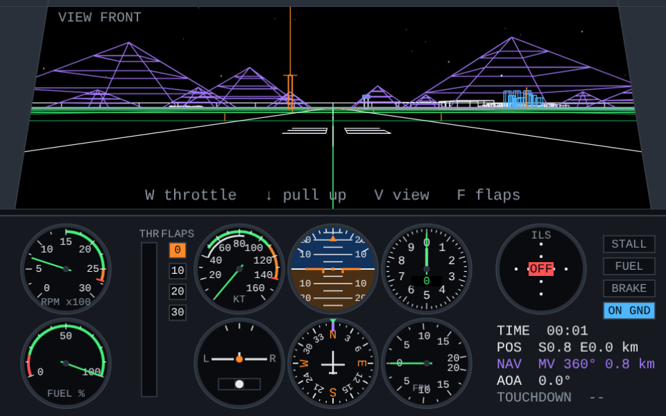
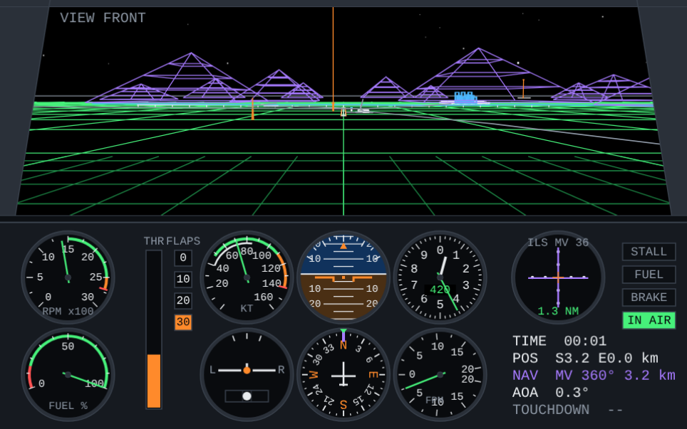
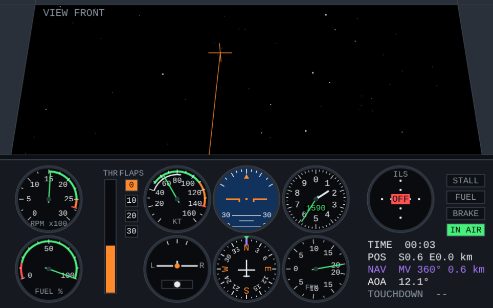
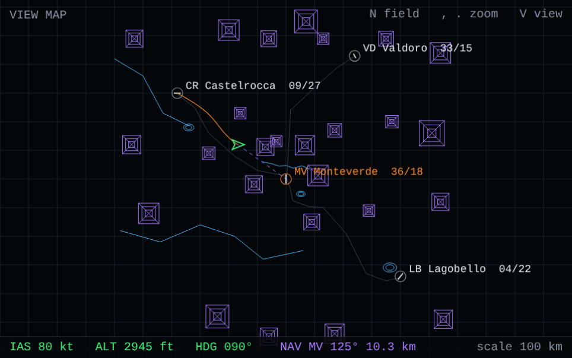
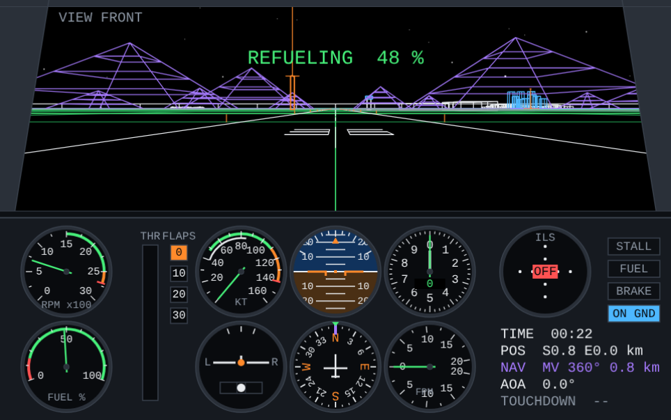

# Vector Cockpit

A wireframe flight simulator in a single HTML file, with a cockpit view and analog instruments, inspired by the early Sublogic flight simulators of the 1980s.


Playable here: [Vector Cockpit](https://tagtthespellcaster.github.io/Vector-Cockpit/)

There is no score and no mission. You take off, fly, and land. The only outcome the program records is a crash, with its cause.

## Screenshots


*Monteverde, runway 36, ready for take-off.*


*Final approach, 3 km from the threshold, flaps 30°, ILS needles centred.*


*Nose raised: the stars turn with the attitude of the aircraft.*


*Map at the widest scale: four fields, roads, rivers, lakes, mountains and the track.*


*Refuelling, stopped on the field with the engine at idle.*

## Features

- **Cockpit view with vector graphics.** Wireframe terrain, runway markings, buildings, mountains, rivers and lakes, drawn as lines on a black screen, with no hidden-line removal, as in the originals.
- **Night sky.** About 380 stars at fixed directions and a moon on a black sky. They turn with the aircraft's attitude, so there is a sense of motion when you look up and the ground is out of view.
- **Instrument panel.** Airspeed indicator, attitude indicator, altimeter, vertical speed indicator, heading indicator, turn coordinator, tachometer, fuel gauge, throttle and flap indicators, ILS needles and warning lamps.
- **Four airfields in a 60 × 60 km region,** with differently oriented runways, a grass strip, villages, two cities, roads between the fields, three rivers, three lakes and 26 mountains.
- **ILS** on three runways. It tunes itself to the runway you are lined up with.
- **Six views:** front, left, right, rear, tower (with automatic zoom on the aircraft) and a full-screen map. One key switches between the map and the view you were in.
- **Navigation.** Choose a destination field and a bearing marker on the heading indicator and a NAV readout show its direction and distance. A light beacon marks each field from about 25 km.
- **Flight model.** Simplified but physically based: lift and drag from angle of attack, stall with warning and buffet, flaps, ground friction, brakes, nosewheel steering, and fuel, with refuelling when stopped on a field.
- **Controls for keyboard and touch,** with an on-screen stick, throttle slider and buttons.
- **Optional sound:** engine tone and stall horn, off by default.
- **One file, no build, no dependencies.** The only external resource is the Google Fonts stylesheet for the panel typeface, with a monospace fallback if it cannot load.

## Quick start

1. Download `index.html` (rename it if your file has another name).
2. Open it in a modern desktop or mobile browser. No server is needed.
3. Press `W` to apply throttle and fly.

To publish it with GitHub Pages, put `index.html` in the repository root and enable Pages for the branch.

If you prefer a local server:

```bash
python3 -m http.server 8000
# then open http://localhost:8000
```

## Controls

| Key | Function |
|---|---|
| `←` `→` | Roll |
| `↓` / `↑` | Pitch: `↓` pulls up, `↑` pushes down |
| `Z` / `X` | Rudder; nosewheel steering on the ground |
| `W` / `S` (or `PageUp` / `PageDown`) | Throttle up / down |
| `B` | Brakes (hold) |
| `F` | Flaps: 0 → 10 → 20 → 30° → 0 |
| `G` | Refuel (stopped on a field, throttle at idle) |
| `V` | Cycle views: front, left, right, rear, tower, map |
| `M` | Toggle between the map and the previous view |
| `N` | Select field (target for bearing and distance, and for restarts) |
| `,` `.` | Map zoom out / in (2–100 km across; at the widest scale the whole region is shown) |
| `P` | Pause |
| `R` | Restart on the selected field's runway |
| `H` | Restart airborne at 1500 ft over the selected field |
| `O` | Sound on / off |

**Touch and mouse.** Drag in the *Stick* square: horizontal is roll, vertical is pitch (down pulls up, as with the keyboard). Release to centre it. Use the *Throttle* slider and the buttons for rudder (hold), brakes (toggle), flaps, refuel, view, map, field, pause, airborne start, restart and sound.

## How the aircraft behaves

The model is a light single-engine aeroplane, deliberately simplified.

- **Pitch commands angle of attack, not climb.** With the stick centred the aircraft trims to about 80 kt in level flight at roughly 40% throttle.
- **Pulling back slows the aircraft, pushing forward speeds it up.** Throttle controls climb and descent.
- **Roll** is a rate command. With the stick centred the wings return slowly to level.
- **Turns** do not compensate altitude. Pull back a little. At 30° of bank and about 76 kt the heading changes by about 6–7° per second.
- **Controls weaken at low speed** and have full effect above about 54 kt.

| | |
|---|---|
| Mass | 1000 kg |
| Wing area | 17.2 m² |
| Maximum thrust | 3200 N, decreasing with speed |
| Maximum lift coefficient | about 1.65 with flaps up |
| Stall speed | about 47 kt with flaps up (lower with flaps) |
| Stall angle of attack | 16° with flaps up, 0.8° less per 10° of flaps |
| Fuel | 100% lasts about 32 min at full throttle, about 1 hour at 40% |
| Refuelling | 4% per second (empty to full in 25 s), on the ground only |
| Physics step | fixed, 120 Hz |

### Take-off

1. Hold `W` until the throttle is at 100%.
2. Keep the centreline with `Z` / `X`.
3. At about 60 kt pull back gently. Lift-off is at 62–65 kt after roughly 270 m on the asphalt runways, about 320 m on the grass strip.
4. Keep light back pressure until about 70 kt, then release. Releasing the stick too early at low speed lets the aircraft sink.
5. With 10° of flaps lift-off comes sooner.

### Stall

The *STALL* lamp lights a couple of degrees before the limit. In a stall the view shakes and the nose drops. To recover: push forward, apply full throttle, level the wings, then pull out gently.

### Approach and landing

The procedure below is built on figures from scripted tests of the flight model. The tests were flown open-loop from a stabilised 3° path on the runway centreline, with no wind, on the Monteverde asphalt runway. Treat the numbers as reference values, not as guarantees.

**1. Plan the approach.** Select the field with `N` and check bearing and distance, and use the map (`M`) to keep clear of mountains. At Monteverde, Castelrocca and Lagobello, line up with the runway at least 5 km out: the ILS is valid up to 25 km, within ±20° of the axis. Valdoro has no ILS, so line up visually with the runway.

**2. Configure early.** Use 20° of flaps on the way in and 30° on final, so that the speed and the descent rate are stable before the flare. Flaps also lower the stall speed.

**3. Use pitch for speed and throttle for the path.** In this model the stick sets the angle of attack, and therefore the speed. The throttle then sets the climb or descent. Do not chase the airspeed with the throttle: set the speed with the stick first, then adjust the throttle to hold the glide slope. Values found for a 3° path, with the stick given as a fraction of full back travel:

| Flaps | Stick back | Airspeed | Throttle | Descent rate |
|---|---|---|---|---|
| 0° | 15% | 74 kt | about 11% | about 390 ft/min |
| 20° | 15% | 72 kt | about 27% | about 380 ft/min |
| 30° | 0% | 80 kt | about 45% | about 425 ft/min |
| 30° | 15% | 71 kt | about 34% | about 375 ft/min |
| 30° | 30% | 64 kt | about 29% | about 340 ft/min |

A target of 70–72 kt leaves a margin above the stall speed (about 47 kt with flaps up, lower with flaps). With the keyboard the stick returns to the centre when the key is released, so use short taps on `↓` and watch the airspeed.

**4. Fly the needles.** The vertical needle is the localizer and the horizontal needle is the glide slope; fly toward them (see *ILS* below). Use small bank angles, 10–15°, and pull back a little in turns, because the aircraft does not hold altitude by itself. Make small, slow throttle corrections for the glide slope.

**5. Flare gently.** At about 20 ft above the runway (6 m) set the throttle to idle and ease the stick back by only about 15% more than on the approach. In the tests this gave touchdowns at 300–500 ft/min with 20–30° of flaps. Starting the same flare at 10 ft gave about 80 ft/min in one run. Pulling back to 50% travel made the aircraft balloon and then drop, with impacts at 960–1300 ft/min, above the 885 ft/min limit. With flaps at 0° one flare produced a hard impact at 911 ft/min, so use flaps for landing.

**6. Roll-out.** After touchdown hold the nose down with `↑`, use the brakes (`B`) and steer with `Z` / `X`. In the tests on asphalt the aircraft stopped between about 690 and 840 m after the threshold. Valdoro is a 900 m grass strip, which has more rolling friction than asphalt. It was not tested, so expect a smaller margin there and touch down near the threshold.

**7. Refuel.** Stop on the field, set the throttle to idle and press `G` (or the *Refuel* button). The fuel rises by 4% per second until it reaches 100%, and it stops at once if you add power or move. A *G refuel* hint appears when refuelling is possible. It works on all four fields, in the runway area and about 25–30 m around it.

**Touchdown limits.**

- A touchdown is accepted with a sink rate up to about 4.5 m/s (885 ft/min), bank under about 24°, nose no more than about 7° below the horizon and ground speed under 75 m/s. The last sink rate is shown as *TOUCHDOWN*.
- Altitude is relative to the runway level; 0 ft means on the ground. All fields are at the same elevation.

### ILS

The ILS is valid from 80 m to 25 km before the threshold, within ±20° of the runway axis and below a 12° glide angle. The dial title shows the field and runway it is tuned to. The vertical needle is the localizer (full scale ±2.5°) and the horizontal needle is the glide slope (3°, full scale ±0.7°). Fly toward the needles. The distance in nautical miles is shown at the bottom of the dial.

### What ends the flight

Water (rivers and lakes), mountain slopes, buildings and other structures, and touchdowns outside the limits above. Press `R` or `H` to restart. The radio mast and the power line near Monteverde are only graphics and cause no collision.

## Instrument panel

| Area | Content |
|---|---|
| Left | Tachometer (green 1500–2500 rpm, red line 2700), fuel gauge, throttle bar, flap indicator |
| Centre, top row | Airspeed (green 48–110 kt, white arc 40–85, orange 110–140, red line 140), attitude indicator, altimeter (long hand hundreds of feet, short hand thousands, digital window) |
| Centre, bottom row | Turn coordinator with slip ball, heading indicator (the card rotates; violet marker shows the bearing to the selected field), vertical speed in hundreds of ft/min |
| Right | ILS dial, lamps (*STALL*, *FUEL*, *BRAKE*, *ON GND* / *IN AIR*), time, position in km from Monteverde, selected field (code, bearing, distance), angle of attack, last touchdown |
| Below the screen | Numeric strip: airspeed, altitude, heading, vertical speed, throttle, flaps, fuel |

## The world

North is `+z`, east is `+x`. The origin is the centre of the Monteverde runway.

| Code | Field | Runways | Size | Surface | ILS | Position from MV |
|---|---|---|---|---|---|---|
| MV | Monteverde | 36 / 18 | 1600 × 30 m | asphalt | 36 | origin |
| CR | Castelrocca | 09 / 27 | 1200 × 24 m | asphalt | 27 | 19 km W, 15 km N |
| LB | Lagobello | 04 / 22 | 1400 × 30 m | asphalt | 04 | 20 km E, 17 km S |
| VD | Valdoro | 33 / 15 | 900 × 18 m | grass | none | 12 km E, 21.5 km N |

Mountains are pyramids up to about 1900 m (6200 ft). The approaches to all runway ends have been checked so that, up to 12 km out and within 1 km of the extended centreline, no terrain rises above a 3° glide path. The light column above each beacon is graphics only; the beacon tower itself is solid. Roads link Monteverde with the other three fields and cross the rivers without bridges.

The map (`M`, or `V` five times) shows fields, roads, rivers, lakes, mountains and your track. A dashed line points to the selected field.

## Adding or changing fields

Everything lives in one `<script>`. The world data is at the top:

```js
const FIELDS = [
  { code: 'MV', name: 'Monteverde', x: 0, z: 0, hdg: 0, hl: 800, hw: 15,
    surf: 'paved', fac: 'full', ils: 0 },
  // ...
];
```

- `x`, `z`: centre of the runway in metres (east, north).
- `hdg`: heading of the first runway end in degrees; the other end is the reciprocal.
- `hl`, `hw`: half length and half width in metres.
- `surf`: `'paved'` or `'grass'`. `fac`: `'full'`, `'medium'` or `'small'` buildings.
- `ils`: `0` or `1` puts an ILS on the first or second runway end; `-1` for none.

Mountains, lakes, rivers and roads are plain arrays (`MOUNTAINS`, `LAKES`, `RIVERS`, `ROADS`). When you add a field, keep mountains and water out of its approach corridors. Long ground lines must be split into short segments, because distance culling only looks at the endpoints of each segment; `lseg()` does this.

## Code structure

The script is organised in this order:

1. Constants, vectors, fields, mountains, lakes, rivers and collision boxes.
2. Wireframe geometry: runways, buildings, roads, terrain.
   Sky: star field and moon direction.
3. Flight model, ground handling, crash rules and ILS.
4. Rendering: projection, clipping, cockpit and tower views, map.
5. Instruments and overlays, drawn on the same canvas (logical size 960 × 600).
6. Input (keyboard, touch, buttons), sound and the main loop.

## Limitations

- The flight model is simplified: no wind, turbulence, engine failures other than running out of fuel, or retractable gear. Refuelling has no cost and no fuel truck, only the 4% per second fill rate.
- It is always night: there is no day mode and no clouds. The stars are graphics only and do not affect visibility or flight.
- No hidden-line removal and no textures, by design.
- Only boxes (buildings, hangars, towers, the bridge, light beacons) and terrain cause collisions.
- The shape of the mountains is a pyramid, and the terrain elsewhere is flat.
- There is no saving of state.
- Tested in headless Chromium (desktop and phone-width layouts) and with scripted flight tests. Other browsers and devices have not been tested.

## Credits

Inspired by the early Sublogic flight simulators. This project is independent and not affiliated with Sublogic or with the owners of any other simulator.
